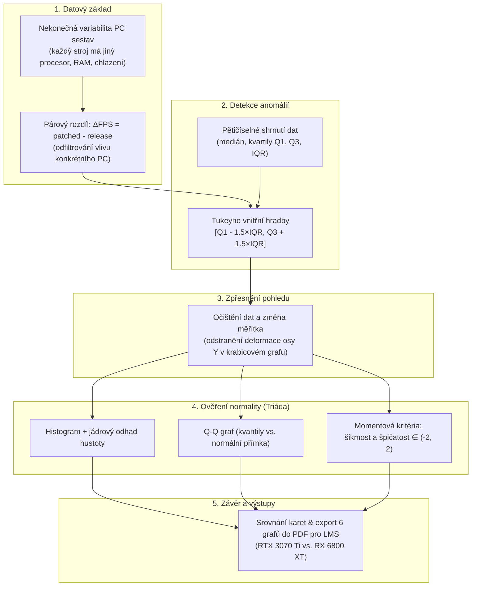

# Explorační analýza dat FPS (Cyberpunk 2077) — Výuková tabule

Vítej na výukové tabuli k domácímu úkolu 1S. Tento dokument slouží jako živý přehled celé analýzy — od motivace a matematického základu přes interpretaci grafů až po konkrétní požadavky na odevzdání do LMS.

---

## 🗺️ Roadmapa analýzy



---

## 📌 Uzel 1: Proč zkoumáme párový rozdíl $\Delta \text{FPS}$?

### 1. Motivace: Problém různých počítačů
Představ si, že bys testoval hru na 100 různých počítačích.
- Někdo má špičkový procesor s vodním chlazením a rychlou RAM. Na takovém stroji běží hra třeba na **95 FPS**.
- Někdo jiný má starší procesor, kde grafická karta čeká na data (bottleneck). Na tomto stroji hra běží třeba jen na **45 FPS**.

Kdybys vzal pouze surové FPS po patchi, nesrovnáváš kvalitu patche ani grafické karty — mícháš dohromady sílu celé počítačové sestavy. Šum mezi počítači by zcela přehlušil samotný efekt aktualizace.

### 2. Zavedení: Izolace vlivu patche
Protože **každý počítač byl změřen dvakrát** (jednou před patchem a jednou po patchi), máme tzv. **párové uspořádání**.

Definujeme novou veličinu pro každý počítač $i$:
$$\Delta \text{FPS}_i = \text{FPS}_{\text{patched}, i} - \text{FPS}_{\text{release}, i}$$

Co tím získáme?
- Všechny konstantní vlastnosti počítače (CPU, rychlost disků, verze Windows, chlazení) se odečtením eliminují.
- Zůstane pouze **čistý přírůstek výkonu**, který zařídil patch 1.5 ve spojení s danou grafickou kartou.

### 3. Jak to vypadá v R kódu
V datech máme sloupce pro obě zkoumané karty:
- `rtx3070ti_pat` a `rtx3070ti_rel`
- `rx6800xt_pat` a `rx6800xt_rel`

V notebooku spočteme rozdíly a převedeme tabulku do dlouhého formátu (`pivot_longer`):
```r
data_diff <- data_clean %>%
  mutate(
    narust_rtx3070ti = rtx3070ti_pat - rtx3070ti_rel,
    narust_rx6800xt  = rx6800xt_pat  - rx6800xt_rel
  )
```
Od této chvíle už v celé analýze pracujeme **výhradně s těmito rozdíly** $\Delta \text{FPS}$.

---

## 📌 Uzel 2: Krabicový graf a detekce anomálií (Tukeyho hradby)

### 1. Motivace: Proč nestačí průměr a co je krabicový graf?
Když máme data o nárůstu výkonu, většina počítačů má zisk kolem $+4$ až $+6$ FPS. Co když ale na jednom počítači během testu na pozadí běžel Windows Update nebo spadly ovladače?
Takový jeden extrémní počítač by zkreslil klasický průměr.

Proto používáme **krabicový graf (boxplot)**, který staví na robustních statistikách:
- **Medián ($\tilde{x}$):** Prostřední hodnota (50 % měření je menších, 50 % větších). Tlustá čára uvnitř krabice.
- **Dolní kvartil ($Q_1$):** Hodnota, pod kterou leží 25 % měření (spodní hrana krabice).
- **Horní kvartil ($Q_3$):** Hodnota, pod kterou leží 75 % měření (horní hrana krabice).
- **Mezikvartilové rozpětí ($IQR = Q_3 - Q_1$):** Výška krabice. Reprezentuje rozpětí **středních 50 % všech měření**.

### 2. Zavedení: Jak Tukey definuje odlehlou hodnotu?
John Tukey vymyslel jednoduché pravidlo tzv. **vnitřních hradeb**:
Vezmeme výšku krabice ($IQR$) a natáhneme ji o $1{,}5$násobek dolů i nahoru:
$$\text{Dolní vnitřní hradba} = Q_1 - 1{,}5 \cdot IQR$$
$$\text{Horní vnitřní hradba} = Q_3 + 1{,}5 \cdot IQR$$

- **Cokoliv leží uvnitř intervalu $[Q_1 - 1{,}5 \cdot IQR, \; Q_3 + 1{,}5 \cdot IQR]$** je považováno za běžnou variabilitu (sem sahají tzv. vousy grafu).
- **Cokoliv leží vně hradeb**, je statisticky **odlehlé pozorování (outlier)** a v grafu se zobrazí jako samostatný osamocený puntík.
- Pokud bod leží ještě dál než za $3 \cdot IQR$, jde o **extrémní odlehlou hodnotu**.

### 3. Co našel kód v našich datech (`rstatix::identify_outliers`):
1. **Nvidia RTX 3070 Ti:**
   - Systém s `id = 38` měl propad $\mathbf{-5{,}50\text{ FPS}}$ (extrémní odlehlá hodnota hluboko pod dolní hradbou). Počítač zřejmě trpěl technickým problémem.
2. **AMD Radeon RX 6800 XT:**
   - Systém s `id = 7` měl nárůst $\mathbf{+13{,}10\text{ FPS}}$ (extrémní hodnota vysoko nad horní hradbou).
   - Systém s `id = 15` měl nárůst $\mathbf{+7{,}50\text{ FPS}}$ (mírně odlehlá hodnota).

---

## 📌 Uzel 3: Proč kreslíme krabicový graf podruhé (Změna měřítka)?

V zadání úkolu je striktní podmínka:
> *Vícenásobný krabicový graf pro data po odstranění odlehlých pozorování vykreslete POUZE v případě, že odstraněním došlo k významné změně vzhledu původního grafu.*

Podívejme se, co se stalo v našich datech:
1. **V původním grafu (Obr. 1):**
   - Kvůli bodu $-5{,}5$ dole a bodu $+13{,}1$ nahoře musela svislá osa Y pokrývat rozsah **od $-6$ do $+14$ FPS**.
   - Samotné krabice (kde žije 98 % všech počítačů) byly stlačené do tenkých proužků a nebylo v nich nic vidět.
2. **V očištěném grafu po vyřazení 3 odlehlých bodů (Obr. 2):**
   - Osa Y se automaticky přizpůsobila a pokrývá jen rozsah **od cca $3$ do $7$ FPS**.
   - Rozlišení grafu se zvětšilo přibližně 5×! Krabice, mediány i vousy jsou krásně čitelné.
   - **Zdůvodnění pro LMS:** Odstranění odlehlých pozorování vedlo k **zásadní změně měřítka osy Y**, proto je zařazení druhého grafu plně opodstatněné.

---

## 📌 Uzel 4: Ověření normality (Statistická triáda)

### 1. Motivace: Proč všichni chtějí „normální rozdělení“?
Gaussovo normální rozdělení $\mathcal{N}(\mu, \sigma^2)$ je v matematické statistice „svatý grál“. Pokud data mají normální rozdělení:
- Ztrácí se chaos: stačí nám znát dvě čísla — **střední hodnotu (průměr)** a **směrodatnou odchylku**.
- Můžeme na ně bezpečně nasadit parametrické testy (t-testy, které přijdou v dalších úkolech).
- Pokud data normální nejsou, průměr je zavádějící a musíme použít neparametrické metody (medián a IQR).

V metodice CV6 se normalita nikdy neposuzuje podle jednoho čísla, ale pomocí **triády tří vzájemně se doplňujících nástrojů**:

```
        ┌──────────────────────────────────────────────┐
        │        TRIÁDA OVĚŘENÍ NORMALITY (CV6)        │
        └──────────────────────┬───────────────────────┘
                               │
       ┌───────────────────────┼───────────────────────┐
       ▼                       ▼                       ▼
 1. HISTOGRAM            2. Q-Q GRAF             3. ŠIKMOST A ŠPIČATOST
 Zvonovitý tvar,        Body leží podél        Hodnoty leží
 jádro kopíruje Gauss    šikmé referenční přímky uvnitř intervalu (-2, 2)
```

---

### Nástroj 1: Histogramy s odhady hustot (Obr. 3 a 4)
- Na ose Y není počet kusů, ale **hustota pravděpodobnosti** (`freq = FALSE`), takže celková plocha sloupců je rovna $1$.
- **Červená plná čára (jádrový odhad hustoty):** Vyhlazený reálný tvar našich naměřených dat.
- **Modrá přerušovaná čára (teoretická hustota):** Jak by vypadala ideální Gaussova křivka se stejným průměrem $\bar{x}$ a odchylkou $s$.
- **Výsledek v našich datech:** U obou karet je histogram symetrický, jednovrcholový (unimodální) a červená křivka téměř přesně kopíruje modrou zvonovitou křivku.

---

### Nástroj 2: Q-Q graf (Quantile-Quantile plot, Obr. 5 a 6)
Tento graf srovnává dvě věci proti sobě:
- **Osa X (Teoretické kvantily):** Kde by body ležely, kdyby data pocházela z dokonalého normálního rozdělení.
- **Osa Y (Výběrové kvantily):** Kde body reálně leží v našich naměřených datech.
- **Červená referenční přímka:** Spojnice bodů, kde $y = \bar{x} + s \cdot x$.

> ⚠️ **Časté nedorozumění (Bacha na to!):**  
> Když body leží podél šikmé přímky, **NEZNAMENÁ TO nulovou odchylku ani že jsou hodnoty stejné!**  
> Právě **sklon té přímky reprezentuje směrodatnou odchylku $s$**. Kdyby byl rozptyl nula, všechny body by ležely na vodorovné čáře v jediné hodnotě.  
> **Body na šikmé přímce znamenají jediné:** Tvar rozdělení našich dat se shoduje s teoretickým normálním tvarem. Extrémy ani střed se neodchylují.

---

### Nástroj 3: Šikmost a špičatost (Číselná kritéria)
- **Šikmost (Skewness):** Měří asymetrii.
  - Kolem $0$ = symetrické rozdělení.
  - Záporná = dlouhý chvost doleva (propady).
  - Kladná = dlouhý chvost doprava (extrémní zisky).
- **Špičatost (Kurtosis s odečtem 3):** Měří tloušťku konců a špičatost vrcholu oproti normálnímu rozdělení (normální rozdělení má po odečtu trojky špičatost přesně $0$).

**Rozhodovací pravidlo CV6:**  
Pokud jsou výběrová šikmost i špičatost v intervalu:
$$\mathbf{(-2, \; 2)}$$
a grafy (histogram a Q-Q graf) nemají patologické odchylky, **data považujeme za normálně rozdělená**.

#### Naše hodnoty před a po očištění:
| Grafická karta | Data | Šikmost | Špičatost | Závěr o normalitě |
| :--- | :--- | :---: | :---: | :--- |
| **Nvidia RTX 3070 Ti** | Původní | $-6{,}09$ | $+43{,}60$ | ❌ Hluboko mimo interval (kvůli bodu $-5{,}5$) |
| **Nvidia RTX 3070 Ti** | Očištěná | $\mathbf{+0{,}131}$ | $\mathbf{-0{,}220}$ |  Ideální normální rozdělení |
| **AMD Radeon RX 6800 XT** | Původní | $+4{,}33$ | $+26{,}50$ | ❌ Hluboko mimo interval (kvůli bodu $+13{,}1$) |
| **AMD Radeon RX 6800 XT** | Očištěná | $\mathbf{+0{,}223}$ | $\mathbf{-0{,}182}$ |  Ideální normální rozdělení |

---

## 📌 Uzel 5: Věcné závěry a požadavky pro odevzdání do LMS

### 1. Výsledné věcné porovnání grafických karet:
Po očištění od anomálií můžeme odpovědět na hlavní výzkumnou otázku: *Jak patch 1.5 ovlivnil výkon karet?*

1. **Obě karty si jednoznačně polepšily:**
   - Všechny očištěné nárůsty leží v plusu (v rozmezí $+3{,}2$ až $+6{,}6$ FPS). Žádná karta na patchi neztratila.
2. **Která karta profitovala více?**
   - **Nvidia RTX 3070 Ti:** Průměrný nárůst **$5{,}28\text{ FPS}$** (medián $5{,}20\text{ FPS}$, směrodatná odchylka $0{,}59\text{ FPS}$).
   - **AMD Radeon RX 6800 XT:** Průměrný nárůst **$4{,}75\text{ FPS}$** (medián $4{,}70\text{ FPS}$, směrodatná odchylka $0{,}67\text{ FPS}$).
   - **Závěr:** Karta Nvidia získala v průměru o **$+0{,}54\text{ FPS}$ více** než AMD.
3. **Variabilita (stabilita přínosu):**
   - Směrodatná odchylka i $IQR$ jsou u obou karet velmi malé a srovnatelné (kolem $0{,}6$ až $0{,}7$ FPS). To znamená, že nárůst byl velmi konzistentní a stabilní napříč všemi testovanými počítači.

---

### 2. Tahák pro odevzdání do LMS (Co kde vyplnit / nahrát)

#### A. Číselné hodnoty do testu v LMS (Souhrnná tabulka):
| Karta | Stav | $n$ | Průměr [FPS] | Sm. odchylka | Medián [FPS] | IQR [FPS] | Min | Max | Šikmost | Špičatost |
| :--- | :--- | :---: | :---: | :---: | :---: | :---: | :---: | :---: | :---: | :---: |
| **RTX 3070 Ti** | Původní | 70 | 5,064 | 1,691 | 5,200 | 0,900 | -5,500 | 6,600 | -6,093 | 43,601 |
| **RTX 3070 Ti** | Bez OP | **69** | **5,284** | **0,5944** | **5,200** | **0,800** | 3,900 | 6,600 | **0,131** | **-0,220** |
| **RX 6800 XT** | Původní | 70 | 4,972 | 1,489 | 4,700 | 1,000 | 3,200 | 13,100 | 4,334 | 26,504 |
| **RX 6800 XT** | Bez OP | **71** | **4,749** | **0,666** | **4,700** | **0,900** | 3,200 | 6,400 | **0,223** | **-0,182** |

#### B. Povinná příloha s grafy (`graficke_vystupy.pdf`):
Do LMS se nahrává PDF soubor, který musí obsahovat přesně **6 číslovaných grafů na samostatných stranách**:
1. **Obr. 1:** Vícenásobný krabicový graf nárůstu FPS pro původní data *(viditelná odlehlá pozorování)*.
2. **Obr. 2:** Vícenásobný krabicový graf po odstranění odlehlých pozorování *(zdůvodněno změnou měřítka)*.
3. **Obr. 3:** Histogram nárůstu FPS pro Nvidia RTX 3070 Ti *(s jádrovým odhadem a normální křivkou)*.
4. **Obr. 4:** Histogram nárůstu FPS pro AMD Radeon RX 6800 XT *(s jádrovým odhadem a normální křivkou)*.
5. **Obr. 5:** Q-Q graf pro Nvidia RTX 3070 Ti *(body podél přímky)*.
6. **Obr. 6:** Q-Q graf pro AMD Radeon RX 6800 XT *(body podél přímky)*.

Všechny tyto grafy generuje poslední buňka notebooku přímo do souboru `du1/graficke_vystupy.pdf`.


